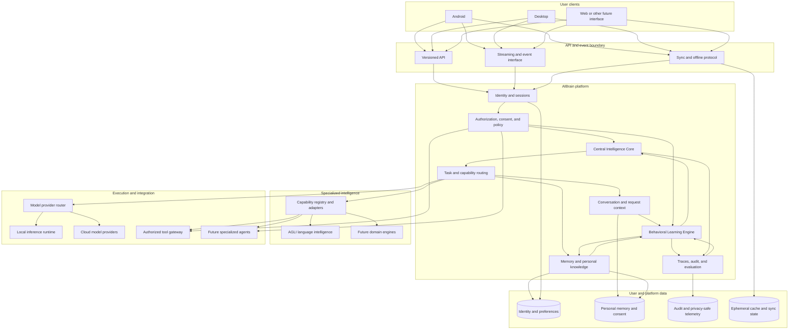

# AIBrain Long-Term Architecture and Future-Readiness Blueprint

Status: Proposed for review
Scope: Repository implementation through Milestones 1-4B
Implementation status: No application, test, configuration, dependency, or existing documentation changes are included in this blueprint

## 1. Product vision and architectural principles

### 1.1 AIBrain's identity

AIBrain is intended to be a universal, personal AI assistant whose primary role is to understand a user's request, select appropriate intelligence and tools, execute only authorized work, explain important decisions, and preserve continuity across the user's devices and changing circumstances.

The system should be able to adapt to different models and services, languages and communication methods, operating environments, and life or work workflows. It is not a chatbot implementation, a provider wrapper, or a collection of disconnected applications. It is a coordinated platform for:

- request understanding and task routing;
- provider-independent model use;
- specialized intelligence capabilities;
- authorized tools and consequential actions;
- personal context and user-controlled memory;
- cross-device continuity;
- transparent, privacy-preserving evaluation and operation.

### 1.2 Responsibilities

The platform should own:

- stable contracts for requests, capabilities, providers, tools, agents, and events;
- task and capability routing;
- authorization, consent, and policy enforcement;
- privacy and data lifecycle controls;
- model/provider selection and resilience;
- request and action context;
- personal memory and synchronization where the user approves;
- cross-platform session continuity;
- auditability, observability, and reproducible evaluation.

### 1.3 Boundaries

The Central Intelligence Core should coordinate and govern work. It should not implement every specialized capability or provider integration internally. Specialized engines, providers, tools, and future agents should remain behind replaceable contracts.

Individual components must not:

- bypass authorization or permission checks;
- infer consent from system access;
- silently retain sensitive or personal data;
- expose secrets or raw content through logs, traces, or provider metadata;
- create or execute consequential actions without the applicable approval policy;
- become the only owner of a portable user-owned data format.

### 1.4 Architectural principles

1. **User control is a system invariant.** Privacy, consent, permissions, correction, deletion, and export are primary behavior, not optional integrations.
2. **Text is the first modality, not the permanent data model.** Contracts should remain provider-neutral and evolve into structured multimodal and streaming events.
3. **One modular system is preferable to unnecessary microservices.** Start with a modular monolith and isolate replaceable components through interfaces.
4. **Core stability, component replaceability.** Stable contracts should remain narrow; implementations and infrastructure can change independently.
5. **Local-first for sensitive personal data.** Cloud execution should be capability-based and explicitly approved rather than implicit.
6. **Capability discovery is separate from implementation.** Registration, implementation, availability, verification, consent, and enablement are different lifecycle states.
7. **Evidence over claims.** A capability is not "implemented" simply because metadata exists; evaluation should verify actual behavior.
8. **Bounded defaults.** Retries, context, payloads, memory, permissions, and autonomy should have explicit limits.
9. **Resilience with user-visible choices.** Fallback and degraded operation must be transparent where they alter privacy, cost, location, or model behavior.
10. **Reversible change.** Components, provider models, memory schemas, and capabilities should support migration or retirement without rewriting the core.
11. **Build today, preserve options tomorrow.** Implement only validated requirements; avoid complete frameworks for future possibilities.

## 2. Target architecture

### 2.1 Target relationship model

The recommended target is a **modular, API-first platform** with replaceable provider, engine, capability, tool, memory, and client layers. A modular monolith can satisfy early deployments and remain deployable as a single process. Components should be separable over time only when real scale or isolation requirements justify service boundaries.

### 2.2 Central Intelligence Core

The existing `OrchestrationCore` is the foundation for this role. It should remain responsible for:

- validating requests;
- selecting a task or goal;
- checking capability availability;
- coordinating adapters;
- enforcing policy and consent;
- assembling context;
- applying bounded execution limits;
- recording privacy-safe decision traces;
- returning stable outcomes and recoverable errors.

The core should not contain provider SDK logic, language metadata logic, memory database logic, or knowledge of every tool implementation. Those concerns belong behind interfaces.

The existing deterministic classifier can remain an initial fallback and explicit-task mechanism. Future model-based routing should be a replaceable classifier implementation using the same task classification contract.

### 2.3 AI providers and model routing

The provider layer should remain provider-independent:

- provider identity and health;
- models and model capabilities;
- local or cloud execution location;
- privacy and cost properties;
- capabilities supported;
- fallback eligibility;
- timeouts and retry semantics.

Model routing should consider explicit user selection, capability requirements, availability, cost, latency, locality, privacy policy, and fallback consent. It must not route personal or sensitive data to a cloud provider unless authorization and data handling requirements permit it.

The existing `AIProvider`, `ProviderRegistry`, `ModelRouter`, health monitor, and fallback executor are appropriate foundations to preserve.

### 2.4 Specialized intelligence engines

AGLI is the first example of a specialized intelligence engine. It should expose capabilities such as language lookup, detection, translation, speech, and accessibility support through versioned contracts, rather than direct embedding in the central core.

Other engines can include:

- domain knowledge;
- productivity;
- scheduling and workflows;
- health or accessibility support;
- reasoning or planning;
- local environment awareness;
- device-specific sensors or interfaces.

Each engine should report capability status and supported modalities, declare required permissions and data classes, and operate through adapters. Engine availability must never be confused with registration or implementation.

### 2.5 Capability and tool systems

Capabilities describe what AIBrain can do. Tools describe the executable operations used to perform capability work.

An ideal capability has:

- an identifier and version;
- human-readable purpose;
- declared inputs and outputs;
- required permissions;
- supported modalities and devices;
- execution location constraints;
- cost and latency expectations;
- availability and verification state;
- deprecation and retirement metadata.

Tools should execute through a constrained gateway that validates schema, policy, consent, target, amount, and action type. The gateway is the preferred place for allowlists, sandboxing, redaction, and consequential-action approval.

### 2.6 Agents and future orchestration

Agents should be specialized coordinators or bounded task executors, not unrestricted autonomous processes. They should receive a scoped goal, context, permissions, deadlines, and allowed tools. They should report plans and outcomes and require approval for consequential or out-of-scope actions.

The central core can initially coordinate individual capability adapters. A higher-level agent framework should be introduced only when real multi-step, stateful workflows exist and require it. When introduced, it should consume capability and policy contracts rather than bypassing the core.

### 2.7 Context, memory, and behavioral learning

Three concepts should remain distinct:

1. **Request context:** bounded state for one conversation or task.
2. **Working context:** relevant session, device, schedule, and task state assembled for a request.
3. **Personal memory:** durable user-approved facts, preferences, goals, corrections, and derived insights.

Behavioral learning should be an explicit opt-in capability with source, purpose, confidence, retention, and revocation metadata. Observation should not imply retention or permission to act.

The proposed **Behavioral Learning Engine** is a dedicated AIBrain subsystem, not an unbounded part of the Central Intelligence Core. It receives only permitted observations from Context and Personal Memory, evaluates potentially useful patterns, records them with confidence and provenance, and submits adaptations for authorization or user review.

It must interact with the following systems without controlling them:

- **Central Intelligence Core:** receives proposed adaptations or preferences and can incorporate an authorized change into future routing or response behavior; it does not grant the engine permissions.
- **Context:** provides only permitted, scoped interaction evidence for short-lived analysis.
- **Personal Memory:** stores only approved and policy-valid learning results, corrections, and reviewable derived preferences.
- **Evaluation:** measures whether an applied adaptation improves outcomes and detects regressions or unintended effects.

The engine is described as future architecture. It is not implemented in the current repository.

### 2.8 Identity, authorization, and permissions

The platform needs a durable identity model that separates:

- person or account;
- user profile;
- devices and sessions;
- workspaces or shared contexts;
- capabilities and tools;
- permissions and consent grants;
- authorization decisions.

Permissions should be scoped by purpose, data, tool, action, location, duration, and user approval. The first implementation need not be a full IAM platform, but persistence and APIs should avoid treating a user as an anonymous API request.

### 2.9 Data storage and synchronization

Use the principle of **user-owned logical data**, even if cloud infrastructure is introduced later:

- personal records have ownership and access policies;
- sensitive data is encrypted;
- sync is explicit and resumable;
- conflict resolution is deterministic or user-mediated;
- deletion is propagated and not merely hidden;
- export and migration use versioned formats;
- offline state is separated from server-authoritative state.

Storage choices should be implemented behind repositories and sync contracts rather than directly inside orchestration or HTTP handlers.

### 2.10 API and event interfaces

REST/HTTP is an appropriate stable API foundation today. The future interface should also support:

- server-sent events or WebSockets for streaming;
- asynchronous work and status events;
- cancellable operations;
- idempotency;
- typed partial and final results;
- device and capability negotiation;
- offline operation queues.

The API should expose capability and provider status without leaking implementation secrets. Request metadata should remain extensible but should be classified and validated.

### 2.11 Android, desktop, and other clients

Clients should be thin presentation and local capability adapters. They should:

- maintain user-visible session state;
- negotiate capabilities;
- provide consent and approval UI;
- support offline queues where appropriate;
- integrate device features through permission-gated adapters;
- synchronize through stable APIs and events;
- render text, accessibility, audio, images, and future modalities through shared response abstractions.

Client-native logic should not alter authorization decisions or personal memory policies.

### 2.12 Local and cloud execution

A request should be able to execute:

- entirely locally;
- with local preprocessing and cloud inference;
- through a remote provider;
- with fallback to another approved location.

Execution-location metadata and policy should be part of routing decisions. The platform should disclose when mode, model, provider, cost, or privacy properties change materially.

## 3. Extensibility and evolution

### 3.1 New AI models and providers

Add providers by implementing the existing provider abstraction and registering the provider. A future provider contract should include capability negotiation and execution location, while preserving the existing health and fallback boundaries.

Stable provider interfaces should include:

- identity and lifecycle;
- supported models;
- supported capabilities;
- health and availability;
- text and multimodal execution;
- cancellability;
- streaming;
- usage and cost data;
- privacy and data-location declarations.

SDK-specific configuration should remain outside the central core.

### 3.2 Local and cloud models

Local and cloud providers should be provider implementations rather than separate orchestration branches. Routing policy should evaluate:

- model suitability;
- execution location;
- device resources;
- energy and thermal state;
- network availability;
- privacy and consent;
- cost;
- latency;
- quality;
- fallback permission.

### 3.3 New intelligence engines

New engines should register capabilities and expose adapters. Adding an engine must not require adding enum values or branches throughout every trace and response model. Modernize the capability identifier and trace contracts to avoid closed-world engine enums when real engine expansion begins.

### 3.4 New capabilities and agents

Capabilities should be discovered from versioned registries rather than hard-coded central mappings. The initial mapping table can remain, but it should be backed by capability metadata and policy. Agents should consume capability and tool contracts, not directly call provider SDKs.

### 3.5 New languages and dialects

Preserve AGLI's separate language and capability registry. Language metadata should evolve independently from implementation capability. Future registries may be database-backed, externally translated, or federated, but lookup and capability status contracts should remain stable.

BCP 47-style language identifiers are a sound foundation for future locales and dialects.

### 3.6 Audio, image, video, and real-time interaction

Introduce content-bearing modality types, streaming parts, media references, and event envelopes as a contract evolution. Avoid placing raw binary content in logging or ordinary JSON without explicit limits.

Each modality needs:

- content and metadata separation;
- size and duration limits;
- storage and retention policy;
- access control;
- transcription or derived-data classification;
- codec or format negotiation;
- cancellation and streaming semantics.

Real-time communication should use events and session protocols while preserving one set of policy and consent decisions.

### 3.7 Devices, operating systems, and interfaces

Keep shared contracts device-neutral. OS-specific integrations belong in adapters. Future interfaces can consume the same capability and event model rather than maintaining separate business logic.

### 3.8 Unknown future technologies

The platform should protect itself from technological surprise by preserving:

- versioned schemas;
- compatibility and migration metadata;
- stable capability identifiers;
- provider and engine adapters;
- replaceable storage and sync services;
- policy and consent as separate enforcement layers;
- open internal event contracts;
- reproducible evaluation.

No framework should be chosen today merely because it may become useful. The architecture should keep components separable and contracts explicit.

## 4. Personal intelligence and continuity

### 4.1 User-owned information

Personal data belongs to a named user and should be portable, inspectable, correctable, deletable, and exportable. Derived data should reference source and purpose.

The platform should distinguish:

- explicit user statements;
- inferred preferences;
- observations;
- derived predictions;
- temporary context;
- sensitive information;
- system configuration.

Inferences should never be presented as facts and should carry confidence and provenance.

### 4.2 Persistent memory

Memory should be introduced as a bounded system with:

- memory types;
- source and origin;
- owner;
- scope;
- purpose;
- confidence;
- sensitivity;
- creation and update times;
- retention policy;
- consent version;
- revocation and deletion state.

Memories must be retrievable by policy, not merely by a full-text or vector similarity search.

### 4.3 Behavioral learning

Behavioral learning should be opt-in and purpose-specific. Suitable learning categories include:

- preferred communication style;
- recurring routine patterns;
- stated goals;
- known device and workflow preferences;
- correction feedback.

Different categories can have different default retention and sharing policies. Automatic learning should not be enabled merely because context was available.

### 4.4 Personal preferences and goals

Preferences should be explicit records where practical. Goals should have:

- owner;
- description;
- scope;
- target or deadline;
- confidence and source;
- consent;
- allowed execution types;
- supersession and deletion rules.

The assistant should ask for clarification if a preference conflicts with a current request or if the goal is unclear.

### 4.5 Cross-device continuity

Continuity should synchronize approved context and memory while respecting device capabilities and risk. A request may start on Android and continue on desktop, but device identity and encryption keys must remain subject to authorization.

The platform should support:

- session handoff;
- resumable tasks;
- conflict and stale-data handling;
- device-local data preferences;
- explicit data minimization;
- revocation of device access.

### 4.6 Adaptation over a user's life

Memory and preferences should support lifecycle changes through:

- explicit review;
- superseding rather than silently overwriting;
- detection of conflicting preferences;
- periodic confirmation;
- correction and archival;
- context-specific rather than universal assumptions.

### 4.7 Memory correction, deletion, export, and retention

Every stored personal record should support:

- view;
- correct;
- delete;
- export;
- retention expiration;
- revoke consent;
- source and policy review.

Deletion should apply to synchronization replicas and derived caches according to policy. Export should include provenance and consent context where useful.

### 4.8 Behavioral Learning Engine

The **Behavioral Learning Engine** should be a dedicated, replaceable subsystem that operates within the identity, consent, retention, and data-classification policies enforced by the platform. It should:

1. Observe only interactions, events, and records permitted for the active purpose.
2. Detect potentially useful patterns and generate bounded hypotheses rather than assumed facts.
3. Separate observations, inferred patterns, confirmed preferences, and explicit user statements.
4. Learn from explicit corrections and feedback, and treat each update as evidence with provenance.
5. Propose adaptations for review or apply only adaptations that the user and policy authorize.
6. Use Evaluation to test whether adaptations improve outcomes, reduce friction, or introduce regressions.
7. Support user review, correction, suspension, deletion, and consent revocation.

The engine is subject to these boundaries:

- It does not independently grant permissions or alter authorization policy.
- It does not treat observation as consent to learn, retain, share, or act.
- It does not silently convert uncertain inferences into facts or personal goals.
- It does not execute consequential actions merely because a pattern was detected.
- It must respect user identity, purpose-specific consent, data sensitivity, retention limits, and cross-device policy.

Its normal data flow is from authorized Context and Personal Memory observations to pattern analysis, then to Evaluation and a review or authorization decision. Accepted adaptations may be stored back into Personal Memory or returned to the Central Intelligence Core as scoped preferences. Raw or derived observations must not bypass policy when they cross subsystem, device, provider, or service boundaries.

## 5. Security, privacy, and trust

### 5.1 Authentication and identity

The platform needs user authentication, device authentication, session security, and auditable account lifecycle. Future shared contexts may require workspace and delegated identity models, but those should be built on stable identity primitives rather than API-specific checks.

### 5.2 Authorization and scoped permissions

Use explicit policy decisions for:

- provider and model access;
- memory access;
- tool and device access;
- external services;
- action type;
- data scope;
- time and location;
- approval requirements.

Authorization policy must be enforced server-side for remote work. Clients must never be the sole authorization boundary.

### 5.3 Consent management

Consent should be:

- purpose-specific;
- understandable;
- revocable;
- versioned;
- stored as evidence;
- checked at execution time;
- easy to review.

Broad consent should not replace action-specific approval.

### 5.4 Secrets and credential protection

Provider credentials and user secrets should use environment or secret-store mechanisms, never request metadata or logs. Future user integrations need per-service credentials with least privilege and revocation.

The existing validation that rejects obvious credentials in public request fields is useful, but it is not a secret-management system.

### 5.5 Data classification and encryption

Establish classes such as public, operational, confidential, sensitive personal, credential, and regulated data. Encryption should cover storage and transport, with key custody appropriate to user and deployment.

Derived representations such as embeddings should receive at least as much protection as source data.

### 5.6 Retention and deletion

Default retention should be short and purpose-driven. Personal memory and audit records should have independent policies. Audit data should not store unnecessary personal content.

Deletion, export, and retention should be documented as system guarantees, not merely configuration options.

### 5.7 Auditability and privacy-preserving traces

The existing decision trace is a strong foundation. Future traces should add:

- request version;
- policy decision;
- capability and provider versions;
- execution location;
- consent grant identity;
- tool and action classification;
- privacy-safe timing and outcome;
- correlation identifiers without message content.

Traces must not contain provider responses or personal content unless explicitly approved for a bounded diagnostic purpose.

### 5.8 External service access

External access should use a tool gateway and integration-specific credentials. Services should receive only the minimum fields required for the request.

Providers and tools should declare network and data-location constraints. Routing must enforce those constraints.

### 5.9 Consequential-action approval

Consequential actions should be denied or suspended until policy and user approval are satisfied. Approval should name the action, target, parameters, cost or impact, and scope.

Examples include:

- financial transactions;
- sending messages;
- deleting or modifying files;
- placing calls;
- creating or changing appointments;
- accessing sensitive device features;
- automating actions in external systems.

The deterministic classifier's unsupported patterns are a conservative foundation, not a complete authorization mechanism.

### 5.10 Isolation

Future plugins and agents should execute within declared trust boundaries. Isolation should enforce:

- network allowlists;
- file and device scope;
- memory visibility;
- provider access;
- secret access;
- resource limits;
- observability;
- version compatibility.

### 5.11 AI safety and untrusted-input boundaries

The platform must define an explicit instruction hierarchy and authority boundary. System and platform policies, identity and authorization decisions, explicit user approval, capability contracts, and tool constraints rank above model-generated suggestions. External content, retrieved documents, files, messages, web results, media, and other users' instructions must be treated as untrusted data unless separately verified.

The model-facing architecture should preserve separation among:

- trusted platform instructions and policy;
- current user instructions;
- approved conversation context;
- personal memory and preferences;
- retrieved or external content;
- model-generated plans and tool requests;
- tool results and outputs.

Prompt-injection and indirect prompt-injection risks must be treated as security threats, not ordinary text ambiguity. External content must not be able to override system instructions, permissions, consent, policy, memory, or a user's explicit decision.

Model-generated tool requests are proposals, not execution authority. Before dispatch, the tool gateway must validate:

- action and capability names;
- schemas and parameters;
- target and scope;
- authorization and consent;
- resource and content limits;
- data classification;
- provider and execution location;
- whether the action is consequential.

Tool outputs may contain untrusted text or instructions. They should be schema-validated, size-bounded, classified, and isolated from instructions. Output content must not be interpreted as authorization or permission, and tool execution must not allow output text to modify policy or memory without a separate trusted validation and persistence path.

Authorization decisions must be independent of model recommendations. The policy layer and tool gateway remain authoritative even if the model requests an action, and external content must never change an authorization, retention, consent, or capability policy.

Consequential actions require human approval according to the action, target, impact, cost, and scope. Approval must be explicit, narrowly scoped, revocable, and recorded as evidence; prior conversation or a detected behavioral pattern is not approval.

### 5.12 Model and dependency supply-chain security

Models, runtime dependencies, integrations, plugins, engines, and tools are execution components. Before registration or deployment, AIBrain should identify provenance and trust requirements appropriate to the component and deployment.

Future supply-chain controls should include:

- model and dependency provenance and responsible publisher or maintainer;
- version pinning or reproducible versions for models and dependencies;
- compatibility declarations for capabilities, schemas, runtimes, and platforms;
- integrity verification for artifacts and update packages;
- vulnerability and license assessment for dependencies;
- trusted provider and integration registration;
- signed or verified updates where the platform's trust model supports it;
- safe updates with staged rollout, health checks, rollback, and retention of the last known-good version;
- plugin and engine trust boundaries, minimum privileges, resource limits, and isolation;
- security review before introducing a new model, runtime, provider, integration, plugin, or engine.

No specific vendor or technology is mandated by this requirement. Supply-chain controls should be adapted to evidence available for each implementation and to the sensitivity of the data and actions involved.

## 6. Capability and engine lifecycle

### 6.1 Lifecycle states

Preserve explicit lifecycle distinctions:

- **registered:** metadata is known;
- **implemented:** code exists;
- **available:** the runtime can execute it;
- **verified:** evaluation or certification has passed;
- **enabled:** policy and the user allow it;
- **deprecated:** replacement or retirement is planned;
- **retired:** discovery and execution are disabled.

The README currently mentions a verified state even though the capability schema represents registered, implemented, and available; the implementation should eventually align documentation and schema.

### 6.2 Registration and discovery

Registration should include:

- stable identifier;
- semantic version;
- engine or provider identity;
- declared interface;
- modalities;
- permissions;
- execution location;
- deprecation and retirement data;
- health and verification status.

Discovery should be separate from activation. Devices and users may see different capabilities depending on platform and policy.

### 6.3 Validation

Every capability should have:

- contract conformance tests;
- security tests;
- bounded execution tests;
- privacy tests;
- provider-independent fixtures;
- end-to-end behavior tests where applicable.

Capabilities that depend on external providers should test adapters and fallback behavior independently.

### 6.4 Versioning

Use capability and schema semantic versions. Additive evolution is preferred; incompatible changes should produce a migration or new capability version. Provider model names may change independently from capability contracts.

### 6.5 Enablement and disablement

The platform should support enabling and disabling capabilities without modifying central code. A disablement should stop discovery and execution while retaining metadata and recovery options.

### 6.6 Updates and retirement

Updates should declare:

- compatibility;
- migration requirements;
- permission changes;
- data format changes;
- deprecation period;
- rollback or disabling strategy.

Retirement should remove execution, revoke permissions, migrate or export data, and preserve enough audit evidence to explain past use.

### 6.7 Engine independence

The core should select capabilities and coordinate adapters. It should not import implementations for every engine or maintain each engine's domain logic. Closed enums for task types and capability IDs should be replaced or supplemented with versioned registry metadata when the core begins supporting substantially more engines.

## 7. Cross-platform and execution architecture

### 7.1 Android

Android should use a native or cross-platform UI, local secure storage, device authentication, permission prompts, and a client adapter to the API and event interface. Device-only features should remain explicitly granted.

The client should support offline messaging or queued actions where data and policy permit.

### 7.2 Desktop

Desktop should share contracts and account/session state with Android. Desktop-specific integrations can include file, application, and accessibility access through a constrained local tool gateway.

It should not receive broader permissions merely because it is trusted in a given session.

### 7.3 Backend services

The current FastAPI process is a suitable modular monolith. It can host HTTP, routing, capability registration, policy enforcement, and initial storage behind modules.

Split services only when independent scaling, isolation, data residency, or operational ownership is demonstrated.

### 7.4 Local inference

Local inference should be an execution provider with:

- model manifest;
- supported capabilities;
- device resource requirements;
- security level;
- health and readiness;
- download or update policy;
- memory limits;
- privacy guarantees.

The core should remain unaware of the local runtime's SDK.

### 7.5 Cloud inference

Cloud providers should declare data residency and privacy properties. User-facing routing should explain whether a request may leave the device and permit refusal or local fallback.

### 7.6 Offline and degraded operation

Implement offline behavior through queued operations and local caches rather than weakening policy. Each queued operation should preserve:

- intent;
- required permissions;
- consent snapshot;
- target provider or capability;
- retry state;
- expiry.

Degraded operation should prefer unavailable or unsupported responses to silent behavior changes.

### 7.7 Synchronization

Sync should be resumable, authenticated, encrypted, and conflict-aware. Shared and personal domains should have separate policies. Sensitive data should support device-local-only mode.

### 7.8 Streaming and real-time events

Use one event schema with:

- event type and version;
- session and task identifiers;
- sequence and correlation;
- status and partial/final state;
- privacy-safe content or media references;
- cancellation.

Streaming should not bypass authorization or retention policy.

## 8. Reliability, evaluation, and observability

### 8.1 Task and routing quality

Measure:

- classification accuracy and confidence calibration;
- explicit versus inferred routing;
- unsupported and consequential-action avoidance;
- capability-selection precision;
- fallback decisions;
- ambiguity and clarification behavior.

Preserve fixed evaluation datasets and historical baseline artifacts, as the current Phase 4A evaluator structure does.

### 8.2 Capability execution success

Track per-capability:

- success and failure rates;
- timeout and retry behavior;
- provider dependency;
- schema conformance;
- latency;
- resource use;
- deprecation or availability changes.

### 8.3 Reliability and recovery

Test:

- cancellation;
- duplicate and delayed events;
- provider failures;
- partial writes;
- sync conflicts;
- retry boundaries;
- circuit and fallback behavior;
- offline recovery.

### 8.4 Latency and resources

Record aggregated timings for routing, capability execution, provider calls, memory retrieval, and sync. Keep resource metrics for CPU, memory, device storage, network, and battery where available.

### 8.5 Privacy and security

Measure:

- credential and sensitive metadata redaction;
- policy bypass attempts;
- denied actions;
- consent and permission coverage;
- cross-tenant or cross-device isolation failures;
- over-retention;
- deletion and export completeness.

### 8.6 Adaptation quality

Personalization must be evaluated for:

- usefulness;
- reversibility;
- recency;
- confidence calibration;
- conflict detection;
- user correction frequency;
- unexpected behavior.

Do not optimize retention volume or inference coverage as a proxy for quality.

### 8.7 User satisfaction and corrections

Feedback should be minimal, explicit, and controllable. Store corrections with purpose, consent, and scope. Capture a reason for poor outcomes when the user chooses, but do not infer dissatisfaction from incidental behavior.

### 8.8 Reproducible evaluation

Continue using versioned datasets, immutable historical baselines, warmup and measured runs, deterministic fixtures, and JSON reports. Reproduction instructions should identify implementation version, configuration, provider/model versions, and environment limitations.

## 9. Current architecture gap analysis

The repository already implements a backend foundation, deterministic mock provider routing, AGLI metadata, capability adapters, bounded context, decision traces, and evaluation tooling. The table below distinguishes the current state from the recommended future state.

| Area | Current state | Desired future state | Why it matters | Cost of postponing | Recommended timing |
|---|---|---|---|---|---|
| Identity and auth | SQLite-backed users and bearer sessions are implemented, with protected personal APIs. Workspace/device identity and full authorization policy are not implemented. | Authenticated users, devices, sessions, scoped identity. | Required before personalized or cross-device data. | Medium; additional device/workspace models can still be added behind the existing identity repository. | Strengthen before multi-device synchronization. |
| Persistent data | SQLite migrations and versioned repositories exist for identity, sessions, memory, observations, adaptations, tools, and audit metadata. | Versioned repositories for identity, memory, consent, sync, and audit. | Provides continuity and recoverable state. | Medium; synchronization, conflict handling, encryption-at-rest, and managed deployment remain separate migrations. | Extend when persistence is selected for production or cross-device use. |
| Personal memory | Bounded request context exists and SQLite personal-memory repositories/APIs are implemented. Retrieval ranking and synchronization are not implemented. | Separate working context and durable, consented memory. | Enables understanding and continuity without conflating transient context with storage. | Medium; retrieval, provenance, and synchronization policy should be established before adaptive use. | Extend through explicit memory APIs before automated learning. |
| Provider integration | Mock provider only; provider interface and router are implemented. | Real local/cloud provider adapters with capabilities and privacy metadata. | Validates external boundaries and real fallback behavior. | Medium; SDK-specific logic could leak into core. | Integrate one real provider when an approved milestone requires it. |
| Central orchestration | Implemented as a deterministic modular core with task/capability mapping. | Policy-aware orchestration with stable capability registry and extensible task metadata. | Avoids core rewrites as engines and modalities expand. | Medium-to-high; enum and mapping changes become wide. | Strengthen interfaces now; generalize at first real expansion. |
| Capability lifecycle | Registry tracks implementation and availability; AGLI also has capability profiles. | Registered/implemented/available/verified/enabled/deprecated/retired lifecycle. | Prevents misleading capability claims and unsafe discovery. | Medium; capability states can diverge. | Add lifecycle metadata before plugin or agent expansion. |
| Agent system | A specialized-agent interface exists, but no planning or lifecycle system is implemented. | Scoped agents with goals, tools, permissions, cancellation, and approval. | Enables complex authorized workflows. | Medium if tool and policy boundaries are deferred. | After capability, confirmation, and tool isolation foundations exist. |
| Tool system | Tool contracts, discovery, a read-only echo tool, and authorization-gated execution are implemented. Isolation, confirmation persistence, and consequential tools are not implemented. | Schema and policy gateway with isolation and approval. | Prevents uncontrolled consequential actions. | High; adding authorization after tools exist is unsafe. | Extend confirmation and isolation before consequential tools. |
| Multimodal support | Text remains the primary runtime; typed media references, stream events, and an SSE-style endpoint exist. Image, audio, video, and real-time processing are not implemented. | Typed media, streaming parts, and real-time event contracts. | Supports future audio, image, video, and live interaction. | Medium; the existing contracts can grow behind adapters. | Add implementations only for validated modalities. |
| Language intelligence | AGLI metadata registry and lookup implemented. | Detection, translation, speech, and accessibility capabilities. | Provides genuine global intelligence rather than metadata only. | Medium; capability status and schemas support partial implementation. | Incrementally after validated language use cases. |
| Cross-platform clients | Backend API only; no Android or desktop client. | Shared contracts, native clients, offline and sync behavior. | Provides actual user continuity. | Medium-to-high; client-only data models can diverge. | Wait for a first client requirement, but lock shared APIs now. |
| Streaming | Synchronous REST and in-process async calls. | SSE/WebSocket, cancellable operations, partial events. | Required for real-time and responsive multimodal systems. | Medium; can coexist with REST if planned. | Add with first real streaming requirement. |
| Local execution | No local inference runtime. | Provider-compatible local runtime with resource and privacy declarations. | Enables offline and privacy-first operation. | Medium-to-high; provider-neutral design avoids the largest cost. | Add after provider contract is validated. |
| Sync | No synchronization protocol or conflict model. | Authenticated, encrypted, resumable sync. | Required for multi-device continuity. | High; data ownership and conflict semantics are difficult to retrofit. | Establish after identity and durable repositories. |
| Deployment | Development/FastAPI process and environment settings. | Explicit local/cloud deployment, health, secrets, migrations, and backups. | Enables reliability and safe upgrades. | Medium-to-high; infrastructure assumptions leak into data and clients. | Before production personal data. |
| Privacy/trust | Basic credential/content filtering and error redaction. | Consent, data classification, encryption, retention, deletion, and privacy-safe telemetry. | Greater intelligence requires stronger control. | Very high; privacy cannot be convincingly added after collection. | Protect now; complete before personal persistence or external actions. |
| Observability | JSON logs and bounded decision traces. | Correlated, privacy-safe audit and operational telemetry. | Supports debugging, trust, and evaluation. | Medium; useful now and cheapest before log volume grows. | Strengthen now. |
| Evaluation | 4A-style versioned dataset, metrics, runner, report, and historical baseline exist. | Continuous provider, engine, capability, privacy, adaptation, and satisfaction evaluation. | Prevents silent regressions and unsupported claims. | Medium; evaluation structure is already present. | Extend only for each real capability. |
| Configuration | Pydantic environment settings. | Validated user/workspace/device/provider policy profiles and secret-store integration. | Supports future devices and deployment modes. | Medium; settings expansion can become scattered. | Add profile abstractions before multiple deployment modes. |

## 10. Architectural roadmap

### A. Protect now

These decisions are inexpensive and limit future migration cost:

1. **Preserve provider-independent interfaces.**
   Keep provider, model, health, fallback, and capability contracts separate from the core.

2. **Preserve capability/adaptor boundaries.**
   Add new engines behind adapters and metadata instead of core imports.

3. **Strengthen trace and contract boundaries.**
   Remove or supplement raw content from traces and replace closed capability/task enums with versioned registry data when expansion begins.

4. **Document data and schema ownership.**
   Record that in-memory context and registries are ephemeral and non-authoritative.

5. **Define stable API compatibility rules.**
   Preserve versioned HTTP contracts and additive evolution.

6. **Retain evaluation provenance.**
   Continue with versioned datasets, historical baselines, configuration identity, and provider/model versions.

### B. Establish before dependent features

These foundations must precede personal, agent, or multi-device behavior:

1. Identity and device/session primitives.
2. Authorization and consent model.
3. Data repositories and migration framework.
4. Data classification and encryption policy.
5. Retention, export, and deletion semantics.
6. Tool gateway and consequential-action approval boundary.
7. Capability versioning and lifecycle metadata.
8. Privacy-safe audit and observability.
9. A provider-neutral streaming or event envelope if real-time capabilities are anticipated.

Dependencies:

- persistent memory depends on identity, data storage, classification, and consent;
- external actions depend on authorization, tool gateway, and approval;
- agents depend on capability lifecycle, tools, policy, context, and cancellation;
- sync depends on identity, storage, encryption, conflict policy, and export/deletion;
- local/cloud routing depends on provider contracts and privacy/location metadata.

### C. Implement when justified

Build these only when concrete requirements and users validate them:

- real external AI providers;
- personal memory and behavioral learning;
- Android and desktop clients;
- local inference;
- audio, image, video, and live communication;
- plugin marketplaces;
- agent frameworks;
- scheduling and workflow automation;
- advanced health or domain engines;
- distributed microservices;
- real-time social or shared intelligence.

Each feature should begin with a narrow contract and evaluation rather than a platform-wide implementation.

### D. Long-term possibilities

These should remain architectural possibilities rather than current commitments:

- edge and on-device federation;
- confidential or encrypted computation;
- multiple synchronized identities and delegated care contexts;
- advanced planning agents;
- immersive or wearable interfaces;
- cross-device sensor fusion;
- federated learning or private personalization;
- autonomous self-upgrading capabilities;
- hardware-specific accelerators;
- new interaction modalities not yet anticipated.

### 10.1 Prioritized roadmap

1. **Now: contract hardening**
   - preserve modular boundaries;
   - define data ownership and versioning rules;
   - strengthen provider-neutral and capability-neutral schemas;
   - improve trace privacy.

2. **Before personal persistence: identity and data foundation**
   - add authentication and authorization;
   - choose storage behind repositories;
   - implement consent, classification, and retention policies.

3. **Before external actions or agents: policy and tool boundary**
   - add permission checks;
   - implement tool gateway;
   - require approval for consequential actions.

4. **Before multi-device use: sync and continuity**
   - add resumable sync;
   - add conflict handling;
   - support offline and device revocation.

5. **For the first real capability expansion**
   - integrate one real provider or one real language capability;
   - extend evaluation and capability lifecycle;
   - validate provider fallback and privacy behavior.

6. **For the first user-facing clients**
   - share API and event contracts;
   - implement consent and device access UI;
   - begin Android or desktop based on validated demand.

7. **Later, based on evidence**
   - agents;
   - multimodal and real-time interaction;
   - local inference;
   - distributed scaling.

## 11. Architecture risks and trade-offs

### 11.1 Overengineering risks

- Introducing microservices before independent scale or isolation needs will increase latency and operational burden.
- A universal plugin SDK could become a larger trust and compatibility problem than the capabilities it serves.
- A generic agent framework can obscure policy and accountability.
- Vector memory without lifecycle and policy can create hidden data retention and incorrect personalization.
- Abstract modality types can become speculative if no first implementation demonstrates their shapes.

### 11.2 Premature abstractions

Avoid adding distributed task graphs, marketplace registries, autonomous learning, or elaborate workflow engines before the corresponding users and capabilities exist.

Useful abstractions now are:

- provider interface;
- capability adapter;
- request context;
- capability registry;
- repository boundary;
- policy decision interface;
- versioned API schema.

### 11.3 Migration risks

- Closed task, capability, and trace enums will require coordinated updates.
- In-memory context and registries are not migration-compatible with durable personal data unless a versioned data boundary is introduced.
- Directly storing provider metadata or SDK objects can tie memory and logs to a provider.
- Evolving API schemas without migration conventions can disrupt future clients.

### 11.4 Security weaknesses

Current gaps include no authentication, no authorization, no secret store, no persistent audit, no tool sandbox, no user consent model, and no explicit action approval. These must not be treated as features to add after the assistant gains more tools.

Credential filtering and redaction reduce accidental exposure but do not provide secure secrets handling or policy enforcement.

### 11.5 Research decisions

The following choices should remain open until evidence exists:

- storage engine;
- identity provider;
- local model runtime;
- sync protocol;
- agent framework;
- memory retrieval design;
- media transport;
- cross-platform client framework;
- encryption key ownership model;
- whether learning is on-device, cloud-assisted, or both.

## 12. Final recommendations

### 12.1 Recommended target architecture

Adopt a **modular monolith with explicit capability, provider, repository, policy, and event boundaries**. Preserve the Central Intelligence Core as a policy-aware coordinator. Keep AGLI and future engines as specialized adapters. Use provider-neutral routing for local and cloud models. Add clients, agents, tools, memory, sync, and multimodal execution only behind these contracts and with explicit authorization.

### 12.2 Critical decisions to establish now

1. Define stable identity and data ownership boundaries.
2. Define authorization, consent, and policy contracts.
3. Define capability lifecycle and versioning.
4. Keep provider and engine implementations outside the core.
5. Preserve privacy-safe, reproducible tracing and evaluation.
6. Establish repository and migration boundaries for future persistence.
7. Keep text contracts extensible toward structured and streamed content.

### 12.3 Decisions that should remain open

- the final database and synchronization technologies;
- the local inference runtime;
- the agent framework;
- the mobile and desktop UI frameworks;
- provider vendors;
- memory retrieval algorithms;
- plugin packaging and distribution;
- cloud deployment topology.

### 12.4 Features that should deliberately wait

- persistent personal memory before identity and consent exist;
- consequential external actions before the tool gateway and approval exist;
- mobile and desktop clients before shared API and sync contracts are stable;
- autonomous agents before capability and policy boundaries exist;
- multimodal, streaming, and live communication before typed event and media contracts exist;
- microservices before demonstrated operational need;
- behavioral learning before user-visible control and retention semantics exist.

### 12.5 Implications for Milestone 4C

The blueprint does **not** authorize starting Milestone 4C or selecting a specific implementation scope. Before choosing 4C work, Milestone ownership and acceptance criteria should remain the source of truth.

The existing Milestone 1-4B foundation is strong enough to continue milestone work, provided that 4C does not:

- add hard-coded engine implementations to the core;
- treat mock providers or AGLI metadata as verified real-world capability;
- create hidden persistent memory or behavioral learning;
- add external actions without authorization and approval;
- bypass the capability registry and evaluation framework.

### 12.6 Foundations to address before continuing

No speculative implementation is required before 4C. The minimum architectural decision work to complete now is to document and preserve:

- user and device identity boundaries;
- authorization and consent as future contracts;
- persistent data ownership and lifecycle boundaries;
- capability lifecycle and versioning;
- privacy-safe trace and telemetry boundaries.

These can remain proposed foundations while 4C continues. They should become implemented requirements before Milestone work introduces personal memory, external actions, agents, or multi-device state.

## 13. Existing design decisions: preserve, strengthen, or reconsider

### Preserve

- FastAPI as the initial backend and versioned HTTP boundary.
- Pydantic schemas and strict extra-field handling.
- `AIProvider`, provider registry, model router, and fallback executor.
- Capability adapter and capability registry concepts.
- Separation of AGLI from the central core.
- Deterministic task classification as an initial conservative mechanism.
- Request and response validation.
- Structured JSON logging.
- Privacy-safe credential validation.
- Bounded request context and provider retries.
- Decision traces and evaluation datasets.

### Strengthen

- Introduce repository interfaces before any database or memory implementation.
- Make capability lifecycle state match both code and documentation.
- Separate transient context, working context, and personal memory.
- Extend provider metadata for locality, cost, privacy, modalities, and credentials.
- Generalize task and capability identifiers beyond today's fixed enums.
- Define trace retention and content rules.
- Add authentication and authorization contracts.
- Validate and test provider and capability registration behavior.
- Define schema and API migration conventions.

### Reconsider

- In-memory-only registries should be treated as development/runtime caches, not long-lived authority.
- The core's fixed task mapping and fixed trace enums should not grow indefinitely.
- Environment-only configuration may not scale to per-user, per-device, or per-workspace policy.
- The "request context" model should not be promoted as personal memory.
- Plain metadata dictionaries need classification and schema evolution.
- Capability availability alone is insufficient for verification or authorization.
- Directly introducing production external providers should wait until credentials, privacy, fallback, and policy contracts are real requirements.

## 14. Proposed Architecture Decision Records

The following ADR subjects are recommended for later approval. Individual ADR files should not be created until a decision is ready.

1. **ADR: Modular-monolith baseline**
   - Reason: avoid premature microservices while preserving replaceable modules.

2. **ADR: Central Intelligence Core responsibility**
   - Reason: define coordination, policy, routing, and context boundaries.

3. **ADR: Provider and model contract**
   - Reason: support local/cloud models and future providers without core rewrites.

4. **ADR: Capability and engine lifecycle**
   - Reason: distinguish registration, implementation, availability, verification, enablement, and retirement.

5. **ADR: Context, memory, and learning boundaries**
   - Reason: prevent transient context from becoming undisclosed persistent memory.

6. **ADR: Identity, devices, and sessions**
   - Reason: establish authenticated cross-platform continuity.

7. **ADR: Authorization, consent, and consequential actions**
   - Reason: make user control and tool safety foundational.

8. **ADR: Data ownership, retention, export, and deletion**
   - Reason: create explicit, portable personal-data guarantees.

9. **ADR: Storage and synchronization approach**
   - Reason: keep data implementations replaceable and define conflict behavior.

10. **ADR: API and event compatibility**
    - Reason: support future streaming, multimodal data, and clients.

11. **ADR: Local/cloud execution routing**
    - Reason: define privacy, cost, latency, and fallback policy.

12. **ADR: Tool gateway and plugin isolation**
    - Reason: constrain external actions and future agent capabilities.

13. **ADR: Agent orchestration scope**
    - Reason: avoid premature autonomy and keep agents policy-bounded.

14. **ADR: Privacy-preserving telemetry and auditing**
    - Reason: explain decisions without retaining unnecessary content.

15. **ADR: Evaluation and release gates**
    - Reason: preserve reproducible quality and privacy regressions.

## 15. Required conclusion

AIBrain's existing foundation supports a long-term evolution in principle, but not every future responsibility is implemented.

The architecture should preserve the provider-independent router, modular adapters, capability registries, deterministic orchestration, typed contracts, bounded context, and reproducible evaluation already present in the repository. It should strengthen them with explicit identity, policy, consent, persistence, memory lifecycle, capability versioning, and tool-security boundaries before adding personal or consequential features.

The first milestone that introduces persistent personal data or external actions should also implement the prerequisites for those behaviors. Additional providers, clients, modalities, agents, and platforms should be introduced through the established boundaries only when real requirements validate them.
